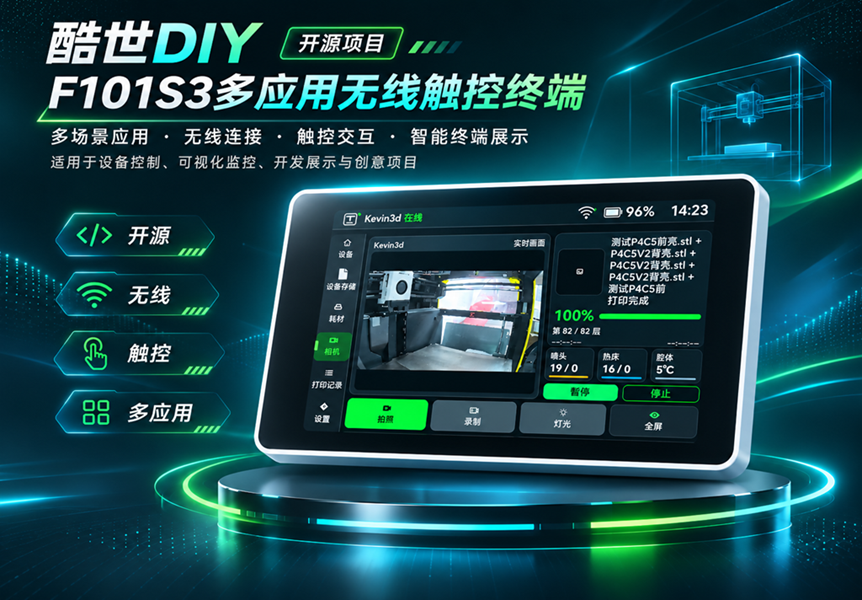

# KSDIY F101S3 开源触摸屏开发板

基于全志 F101S3 的多应用触摸屏开发板。4.3 英寸版本是入门和示例的基线，硬件采用 MIPI 显示和触摸，支持 H.264 硬解，配套 AIC8800D40L 无线模块。应用示例涵盖桌面 UI、TF 卡播放、无线副屏、Action 6 取景及设备监控。

## 仓库入口

| 目录 | 内容 |
| --- | --- |
| [hardware](hardware/README.md) | 4.3 英寸 V2 的 Altium PCB 源文件、元件库、机械模型、原理图 PDF、Gerber、BOM 和坐标 |
| [firmware](firmware/README.md) | 按板型整理的 IMG，以及一份拓竹屏应用源码与板级配置参考 |
| [firmware/images](firmware/images/README.md) | 4.3 英寸与 10.1 英寸镜像，附版本和 SHA-256 |
| [docs/teaching](docs/teaching/README.md) | F101 开发板教学包、离线手册、主机实验和 AI 协作模板 |

## 从这里开始

1. 核对板上版本及屏幕型号。4.3 英寸 V2 的 PCB 文件、[原理图 PDF](hardware/4.3-inch-v2/schematic.pdf) 和制造文件入口列在[板型说明](hardware/4.3-inch-v2/README.md)。
2. 阅读[首次点亮与恢复](docs/teaching/课程/02-首次点亮.md)，选择匹配芯片、Flash 和屏幕的固件。
3. 准备配套全志 SDK 后，按[编译第一个应用](docs/teaching/课程/03-编译第一个应用.md)从木鱼示例开始。AI 辅助开发可直接使用[项目上下文](docs/teaching/AI协作/F101项目上下文.md)。

4.3 英寸和 10.1 英寸使用不同屏参及触摸适配。10.1 英寸镜像供对应屏幕调试。拓竹屏的 SDK 依赖和集成路径见[源码说明](firmware/bambu-panel/README.md)。
